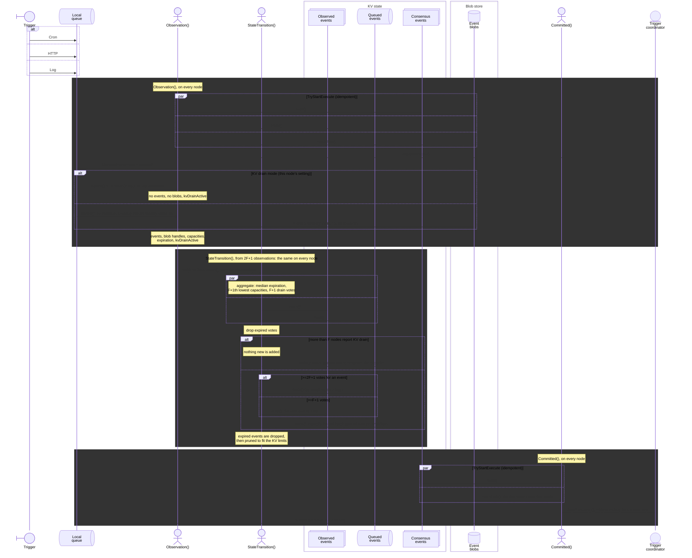
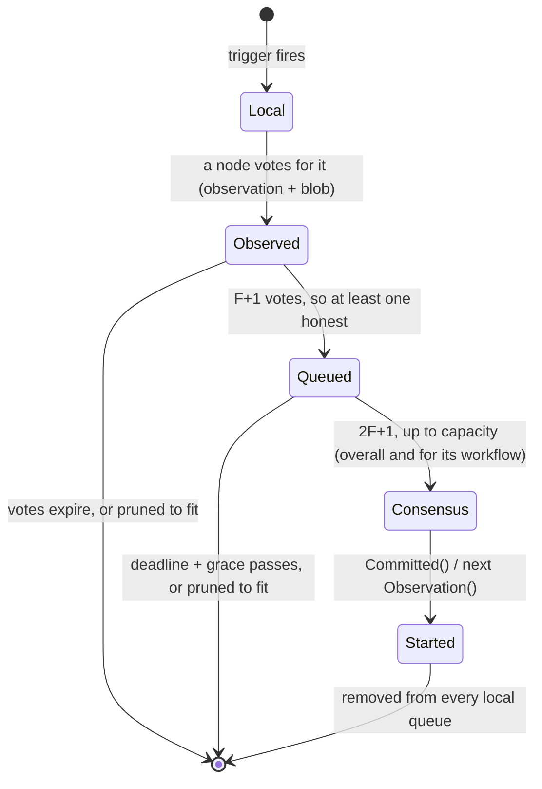

# Consensus Queue Reporting Plugin

An OCR3.1 reporting plugin that makes a DON agree on which trigger events to execute, so that each event runs once,
however many nodes saw it. See the package documentation in `queue.go` for the design; this file is the map.

## Round

Every node keeps a local queue of the coordinated trigger events it has seen (`triggers.Queue`). Each OCR round:

`Observation` also runs the start-and-remove step because `Committed` is not guaranteed to run (a restarted node may have
missed it). It is safe to repeat: starting is deduplicated by the workflow engine on the execution ID, and removing is
idempotent.

## An event's life

Nothing retries a failed start: once an event is in consensus it leaves the queue whether or not starting it worked.

## KV state

| Key | Holds |
| --- | --- |
| `observed_events::index` | events with fewer than F+1 votes: who voted, and each voter's blob |
| `queued_events::index` | events with 2F+1 consensus, waiting for capacity, in priority order |
| `consensus_events::index` | events chosen to run this round |
| `blob_handles::index` | the blob handles that queued and consensus events refer to |

Everything is bounded by the limits in the job's `PluginConfig`, which `Validate` checks (and the calibration tests in
`config_test.go` size). A voter has one blob per event, so repeated votes never grow the state.

## Fault tolerance (N = 3F+1)

- Capacity is the F+1th lowest of what nodes report, with nodes that don't report a workflow counting as zero, so F
  faulty nodes can neither raise it nor starve a workflow. Expiration is the median.
- An event needs F+1 votes, so a faulty node can't make one up. Its blob is checked when the observation is validated.
- Observations are bounded (events, blob handles, sizes) and an oversize blob is rejected when it is read, so a faulty
  node can't make the others spend unbounded CPU or storage.

## KV drain recovery mode

`FeatureConsensusQueueKVDrainActivePeriod` is a global setting for emptying the plugin's state without consensus on new
events. Each node reads it every round (never cached) and reports the result as `kvDrainActive`. With more than F nodes
reporting it, the round is a drain round:

- `Observation` reports no events and no blobs (`ValidateObservation` rejects anything else), and discards the front of
  the local queue so it doesn't fill up.
- `StateTransition` adds nothing from observations, takes every queued event whatever the capacity, and drops expired ones.
- `Committed` starts the consensus events as usual.

## Shadow mode

The plugin doesn't know about shadow mode. During `FeatureShadowTriggerModeActivePeriod` the coordinator's
`StartExecution` logs and counts the event (`platform_engine_trigger_event_shadow_skipped_total`) instead of starting it;
the workflow runs it from its own queue.

## Metrics

All carry `configDigest`. Prefix `platform_consensus_queue_`; the beholder wrapper adds the usual method duration, size,
KV and blob metrics, and `platform_ocr3_1_reporting_plugin_committed_seq_nr`.

| Metric | Meaning |
| --- | --- |
| `observed_events_total`, `observation_events` | events in this node's observations |
| `admitted_events_total` | events that reached consensus and joined the queue |
| `consensus_events_total` | events chosen to run |
| `dropped_events_total{reason}` | events removed without running: `expired`, `expired_observed`, `pruned_observed`, `pruned_queued` |
| `discarded_events_total` | events removed from the local queue by drain mode |
| `queue_depth{orgID}` | queued events by org (`unknown` for workflows not registered on this node) |
| `observed_depth` | events waiting for F+1 votes |
| `state_bytes{key}` | size of each KV value written by the last transition |
